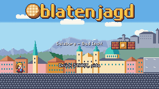
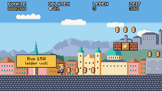
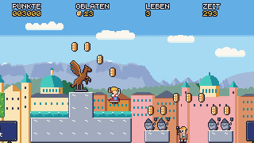
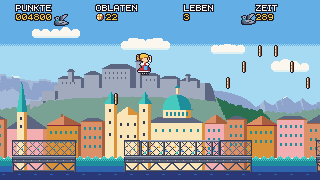
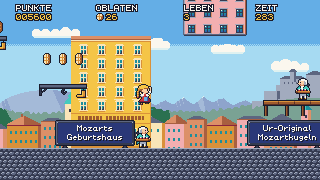
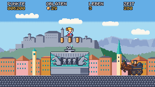
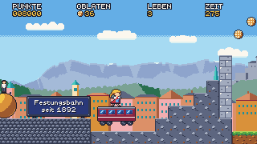
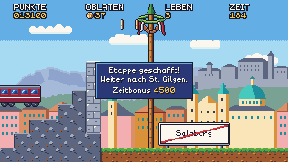

# M1 – Stage 1: Salzburg (first playable): milestone report

Date: 2026-10-18 · Branch `m1-salzburg` → merged into `main`, tag `m1`.

## Result

Stage 1 Salzburg is playable from the title screen to „Fortsetzung folgt …", natively (noVNC) and in the browser (wasm). `cargo xtask verify` passes with every layer real (~116 s): 455 tests, 108 replays (all deterministic), 22 approved goldens, solver, wasm-smoke and vnc-smoke.

 
 
 
 

More: [contact sheet](M1/contact_sheet.png) · [solver filmstrip](M1/solver_filmstrip.png)

## What was built

| Area | Summary |
|---|---|
| Stage | `01_salzburg.level`, 262×17: Busbahnhof → Mirabellgarten → Makartsteg → Getreidegasse → Domplatz/Festung, ending at the Maibaum and the Ortsende sign |
| Player | Resi (Normal + Zuckerschock), stomp + bounce, hurt with 120 i-frames, head-bump on growth (D-024) |
| Items/blocks | Oblaten, Oblatenkisten, bricks (break, `oblaten_10`), Mozartkugel, Zaunerstollen, score popups |
| Enemies | Selfie-Tourist, Taube (+ sitting), Mozartkugel-Verkäufer + thrown ball, Fiaker (bounce, no damage) |
| Moving platform | Festungsbahn waits for its rider (D-030), carries exactly, stairs underneath (D-027) |
| Flow | Title, stage intro, pause (palette panel), checkpoint, whole-level reset on death, game over + continue, time-up, Maibaum goal sequence with height zones + Wurstkranz, time bonus, stage-clear panel, back to title |
| HUD/text | Outlined HUD and popups (D-037), all German text in `de.toml` (27 keys), signs as entities with the jokes |
| Art | Resi, 4 enemies, items/props, Salzburg tileset with autotiling, 4 parallax layers, 7 landmark props (Pegasus, Zwerge, Residenzbrunnen, Geburtshaus, Sphaera, Dombögen, fountain water), title logo — all art-director APPROVED |
| Engine | Level format v2, entity framework, props (back/front, dx), autotile families, parallax with y offset, background generators |
| Tooling | Solver with recoverability jump windows (D-033) enforcing `min_jump_window`; pit-recovery lint; replay expectations for score/Oblaten/lives/y/events; app embeds all levels |

## Difficulty and numbers

- Solver: complete at frame 1601 (~27 s), 16 jumps, narrowest jump window **7 frames** (target ≥ 6).
- Relaxed full run ~65 s; 81 Oblaten reachable; no softlocks (3 QA passes).

## Reviews and acceptance

- **QA**: four rounds (items/power states, enemies/platform/flow, full level, acceptance) — 7 bugs found and fixed, each with a regression test or replay; final verdict after the D-040 camera fix: all M1 items confirmed in the game.
- **Art-director**: every asset and 22 goldens approved (most after 1–2 rounds); M1 art accepted.
- **Game-designer**: Stage 1 matches the spec, jokes land, all German text correct; one blocking fix (checkpoint punchline sign, D-039) done.
- **Code review**: every code branch reviewed; all blocking findings fixed before merge.

## Decisions in M1

D-020 … D-040 — see `docs/decisions.md` (sprite catalog, autotiling, level format v2, QA rulings, car waits for rider, props, recoverability jump windows, Wurstkranz at 7 tiles, goal camera, …).

## Deferred (see `docs/backlog.md`)

- Sound-of-Music tour group (stretch), Postbus tourist crowd, Kapitelplatz chess pieces.
- Polish: floating Getreidegasse façade blocks, Festungsbahn rail line, Untersberg ridge, stage-clear panel position, title subtitle outline, camera framing at the grandstand.
- Tooling: frozen-frame wasm check, tour↔solver coupling test, jump-window metric polish.
- M2 notes: time limit from measured runs, keep the Postbus 150 gag, apply D-032/D-038/D-039 from the first draft.

## Process notes

- Up to six agents ran in parallel in git worktrees; the disk filled once (D-009 addendum: delete worktree build dirs on merge).
- Most review rounds converged in round 2; the work loop's rule "bug replays land with their fix" kept the milestone branch green.
