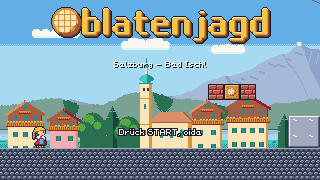
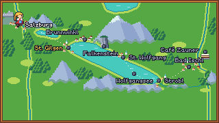
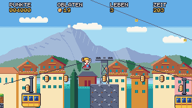
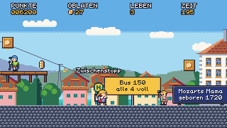
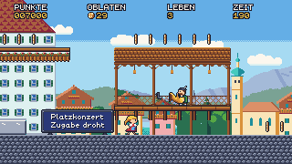
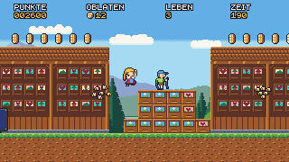
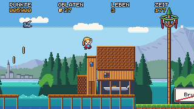
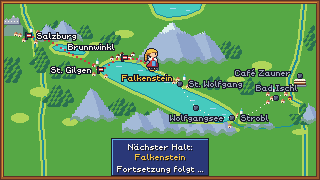

# M2 – Stage 2 St. Gilgen + Stage 3 Brunnwinkl + route map: milestone report

Date: 2026-10-19 · Branch `m2-stgilgen-brunnwinkl` → merged into `main`, tag `m2`.

## Result

The run now goes Salzburg → route map → St. Gilgen → route map → Brunnwinkl → teaser „Fortsetzung folgt …" → title, with score, lives, Oblaten and Zuckerschock carried across stages. `cargo xtask verify` passes on the milestone branch: fmt, clippy, tests, wasm build, all lints, solver, 174 replays (all deterministic), 53 approved goldens wasm-smoke and vnc-smoke. vnc-smoke ran separately after the human's own game window on `:1` was closed (4 shots equal the goldens).

 
 
 
 

## What was built

| Area | Summary |
|---|---|
| Stages | `02_st_gilgen.level` (280×17, 6 sections: Busbahnhof, Zwölferhorn gondolas, Mozartplatz, Ischler Straße houses, Seepromenade, Anlegestelle) and `03_brunnwinkl.level` (240×17, 5 sections: Uferweg, Kornmühle, Bienenhäuser, Fünf Häuser, Badesteg + Bootshaus) |
| Flow | Route data, stage switch after the goal sequence, carry-over, continue restarts the current stage, teaser after the last playable stage, `--level` starts a run at any station (D-042, D-047) |
| Route map | Salzkammergut map with Arrive/Walk/Wait/Teaser phases, START skip, auto-continue, station labels (D-043) |
| Enemies | Nordic-Walker, Blasmusiker + notes, E-Biker (telegraph, crash „Hoppala!"), Bienenschwarm (figure-eight, `dir`/`len`/`phase`/`dy`) (D-046, D-048) |
| Platforms | Zwölferhorn Gondel, a free-running ping-pong platform (D-044); a platform may carry Resi past the camera's left edge, and the camera follows her (D-051) |
| Physics | Water tiles kill only after Resi has sunk 8 px, so coyote time works at every water edge (D-050) |
| Level format | Entity on a decorative tile (`tile = …`), swarm `dy`, new tiles `wall_village_bg`, `roof_bg`, `balcony`, `facade_village`, `roof_shingle`, `chimney`, `jetty`, `jetty_post`, `forest_path`, `beute`, Wolfgangsee water (D-049) |
| Art | 5 enemies + gondola, St. Gilgen and Brunnwinkl tilesets, 10 props (Talstation, Mozartbrunnen, Musikpavillon, Bienenhaus, Bootshaus, …), 4 parallax layers, route map, `é` glyph — all art-director APPROVED |
| Tooling | Tour↔solver and flow↔solver coupling tests, frozen-frame wasm check, recorder frame cap, jump-window polish, contact-sheet fixes |

## Difficulty and numbers

| Stage | Solver complete | Jumps | Narrowest window | Relaxed run | Time limit | Oblaten |
|---|---|---|---|---|---|---|
| Salzburg | 1601 | 16 | 7 | ~65 s | — | 81 |
| St. Gilgen | 1723 | 17 | 10 | ~66–68 s | 210 s | 85 |
| Brunnwinkl | 1468 | 16 | 11 | ~60–64 s | 200 s | 53 |

Time limits follow D-045 (3 × a relaxed run, clamped to 200–300 s).

## Reviews and acceptance

- **QA**: two passes. The stage/route pass found 2 bugs, both fixed with regression replays: no coyote time over water (D-050), and the camera edge pushing a gondola rider into the ravine (D-051). It also produced level notes, all addressed in the level pass. The acceptance pass returned ACCEPTED with 0 bugs. It covered every water edge in both directions, time-up, the boathouse collision (30,000+ fuzz runs) and game over in the last stage, and added 14 regression replays.
- **Art-director**: every new asset approved (the boathouse in round 2). The 33 tour, flow and map goldens were approved after one round of fixes: title subtitle moved into the sky, checkpoint popup raised, bus boards moved, swarms lifted. Two M1 title goldens were re-approved for the subtitle move.
- **Game-designer**: ACCEPTED. One sign text changed to avoid an unintended double meaning (D-052), and the spec now matches the shipped layout.
- **Code review**: every code branch reviewed (E9–E13); no blocking findings left.

## Decisions in M2

D-041 … D-052 — see `docs/decisions.md`. They cover stage scope, flow and carry-over, the route map, gondolas, time limits, enemy rules, the route engine, entity tiles and tours, the water sink rule, the platform camera exception, and the bus sign text.

## Known issues

- The wasm route is covered by wasm-smoke (live frames) and by native replays on the same code. No browser-side replay of the route has been run yet (backlog, MW).

## Deferred (see `docs/backlog.md`)

- Level: raise the St. Gilgen Gastgarten (Zuckerschock clearance), Gondel C timing relative to B, house 4's gable under the HUD, the walker passing in front of the Ischlerbahn sign, swarm #4 touching the grass by 1 px.
- Art/renderer: pole-score popup position, „Brunnwinkl" map label placement, sinking-into-water overlay, a left look-ahead while carried left, shot-frame polish on two goldens.
- Tooling: verify runtime keeps growing (about 4.5 min of steps), mostly in tests and the solver; vnc-smoke can't run while a human's game window is open on `:1`.

## Process notes

- Up to four agents ran in parallel in worktrees. A dedicated integration branch combined two engine branches, the QA replays and the final level pass, so that the art-director needed only one final golden round instead of one per change.
- Physics changes (water, swarm anchor) re-routed the solver. The coupling tests made every copied solver block fail loudly until it was re-copied.
- Running `check` and `verify` at the same time collides in the shared solver temp dir. Run them one after the other.
