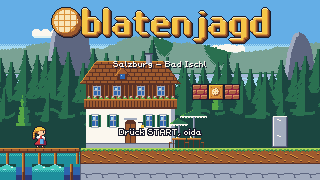
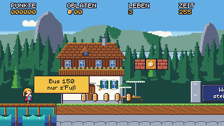
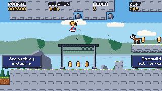
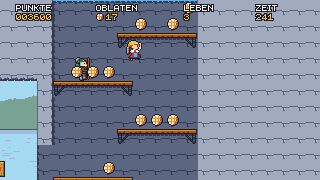
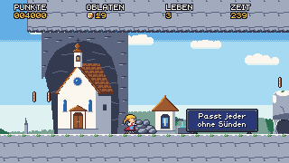
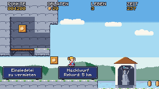
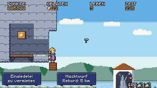
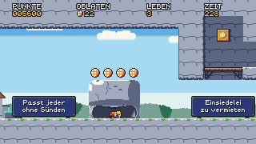
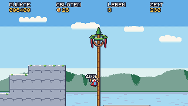
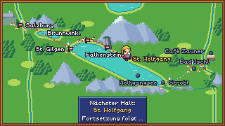

# M3 – Stage 4 Falkenstein: vertical climbing, Hackl, Durchkriechstein: milestone report

Date: 2026-10-19 · Branch `m3-falkenstein` → merged into `main`, tag `m3`.

## Result

The route now continues after Brunnwinkl to Stage 4 Falkenstein, the first climbing stage. It goes from the Fürberg landing via the Kreuzweg, a rockfall slope and a 9-column shaft to the Falkensteinkirche, past the Durchkriechstein, the Einsiedelei and the Hackelwurfkapelle, up to the Maibaum on the Aberseeblick. The teaser after it points at St. Wolfgang.

`cargo xtask verify` passes on the milestone branch, with every layer real: fmt, clippy, tests, wasm build, lints, solver, 226 replays (all deterministic), 83 approved goldens, wasm-smoke and vnc-smoke.

 
 
 
 
 

## What was built

| Area | Summary |
|---|---|
| Stage | `04_falkenstein.level`, 240×42, `camera = "climb"`. Six sections, a 9-column shaft of planks, two lethal clefts, a checkpoint before the shaft, an optional crawl-through and an optional Hackl (D-053, D-064) |
| Climb camera | Opt-in per level. It settles the feet at screen y 148, follows up in the air, follows falls down to a limit, and kills Resi at the death line below the screen. Vertical activation, a calm one-way goal framing, and background `factor_y` (D-054, D-059). Side levels are bit-identical |
| Hackl | Third power state: big, breaks bricks. RUN throws axes in a fixed arc, at most 2. A hit steps Hackl → Zuckerschock. It carries over to later stages and shows in the intro and on the map (D-056, D-060) |
| Durchkriechstein | DOWN at the mouth starts a scripted, invulnerable crawl. Normal Resi gets +1 life; a powered-up Resi sheds to Normal with „Ballast weg!". Once per attempt, always optional (D-057) |
| Enemies | Pilger (walk off ledges, files wake together), Gams (stand/crouch/hop, never leaves its ledge), Steinschlag (telegraphed rockfall counted only in range and on screen; shelter under nets) (D-058, D-061) |
| Tiles/props/art | Limestone tiles (`kalkfels`, `kalkfels_bg`, `steig`, `steig_wall`, `netz`, `netz_post`) with one-way autotile joins (D-063), 7 landmark props, `bg_falkenstein`, a deep lake band, Hackl Resi plus crawl anims, 6 enemy sprites — all art-director APPROVED |
| Tooling | Climb lints (fall depth, niche height to solid ground (D-062), tunnel geometry, shaft width), climb solver (x + height, height-checked recovery around airborne checkpoints), `power=` replay expectation, coupling tests extended to the Falkenstein tour |
| Map | Station labels get an alternate slot when a big Resi would cover them at a screen's end dot (D-060) |

## Difficulty and numbers

| Stage | Solver complete | Jumps | Narrowest window | Relaxed run | Time limit | Oblaten |
|---|---|---|---|---|---|---|
| Brunnwinkl | 1468 | 16 | 11 | ~60 s | 200 s | 53 |
| Falkenstein | 1542 | 23 | 12 | ~85 s | 255 s | 68 |

Falkenstein is harder than Brunnwinkl through its length, its height and its hazards, not through tighter jumps (D-064).

## Reviews and acceptance

- **QA**: a full pass over the stage and its mechanics, and an acceptance pass (ACCEPTED, 0 bugs; includes one replay of the whole route Salzburg → Falkenstein → teaser carrying the Hackl).
  - Bug found and fixed: Pilger #8 was missing from the grid.
  - Level notes fixed: garden wall, H-box reach and safety, the closed cave, Gams #1 not stompable, checkpoint next to the cleft.
  - Engine polish fixed: goal camera jerk, Pilger files splitting, a map label touching Resi.
  - 30+ regression replays added, including the relaxed run, the flow replays and the crawl edge cases.
- **Art-director**: every M3 asset approved in up to 3 rounds. The Falkenstein package needed the most work: strata repeat, back-wall notches, net mesh, boulder shape, the lake gap. All 25 Falkenstein/route-map goldens were approved in round 2, plus the Hackl and crawl test-level goldens.
- **Game-designer**: ACCEPTED. All text correct, jokes land, deviations recorded in D-064.
- **Code review**: E14–E19 each reviewed. Blocking findings fixed before merge: the niche lint vs nets (D-062), the overly broad tile join (D-063), and a solver feet bug found by the level designer (E17).

## Decisions in M3

D-053 … D-064 — see `docs/decisions.md`.

## Known issues

- The browser build is checked by wasm-smoke (live frames). The route through Falkenstein is proven by native replays on the same code. No browser-side replay has been run (backlog, MW).
- verify takes about 6.5 min of steps (test 4 min, solver 2 min). It is still within budget, but it grows with every stage.

## Deferred (see `docs/backlog.md`)

- **Art**: a cave-mouth shadow edge, a Hackl shot at the foot, the pigeon contrast, and the „Ballast weg!" popup over Resi's head.
- **Engine**: Hackl-area framing (the axe lane is below the screen on the H-box top); the goal-camera floor catch-up after a big drop; four map-label collisions on later stations.
- **Design**: tighten the jump windows in Stage 5, the Zaunerstollen rolling into the saddle cleft, and the descent to Ried.

## Process notes

- **Parallel work**: up to six agents worked in parallel (three engineers, three pixel artists). Merge order and hooks were set up front: E16's defeat-by-projectile entry point and E14's activation helper let E15 plug in without rework.
- **Art review against the real renderer**: approvals given on mock composites had to be re-checked in the real renderer. Two renderer issues (tile joins) only showed up there.
- **Concurrent check and verify**: running `check` while `verify` runs still collides in the solver's temp dir. Run them one after the other.
