# M4 – Stage 5 St. Wolfgang: milestone report

Date: 2026-10-19 · Branch `m4-st-wolfgang` → merged into `main`, tag `m4`.

## Result

The route now runs Salzburg → St. Gilgen → Brunnwinkl → Falkenstein → St. Wolfgang, then into the teaser for the Wolfgangsee.

Stage 5 starts in Ried and takes the Schafbergbahn over a gorge to the Alm. From there it passes the bus park and tunnel, the Markt with the Pilgerbrunnen and the pilgrimage church, and the Weißes Rössl with its Kaiserterrasse. It continues along the Seebad and the promenade to the Maibaum at the boat landing hall.

`cargo xtask verify` passes on the milestone branch. It covers fmt, clippy, tests, the wasm build, lints, the solver, 282 replays (all deterministic), 107 approved goldens, wasm-smoke and vnc-smoke.

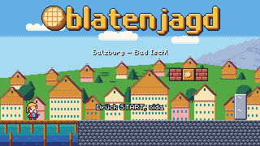 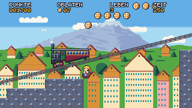
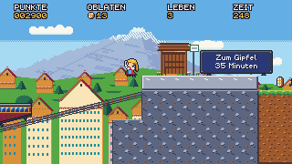 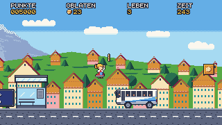
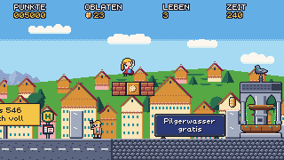 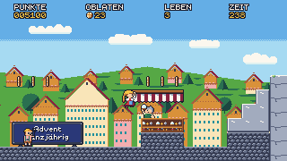
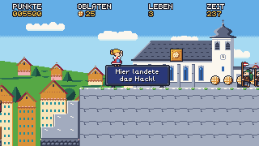 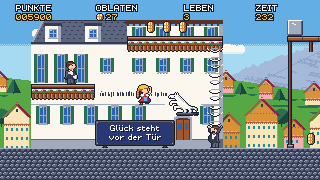
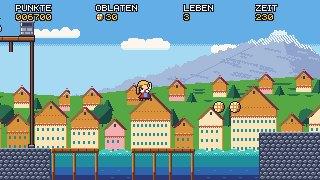 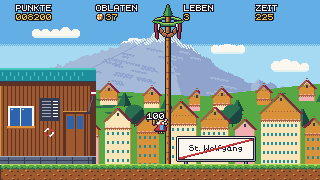 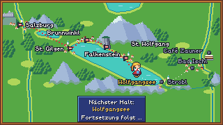

## What was built

| Area | Summary |
|---|---|
| Stage | `05_st_wolfgang.level`, 300×17, side camera, six sections (D-066, as-built addendum, D-073) |
| Schafbergbahn | A cog-railway train. It waits for its rider, then climbs a 1:4 track over a lethal gorge on the Festungsbahn state machine. The roof is pixel-snapped to the drawn rack rail, with steam puffs and a swept-body clearance lint (D-067) |
| Enemies | Operettensänger (inhale telegraph and a high-C column that hurts before any stomp, „Bravo!", D-068). Souvenirstand rolling Schneekugeln that shatter on walls (D-069). Reisebus: telegraph → drive → optional photo stop; roof bounce, side hurt, lane lint (D-070) |
| Hackl | Every new kind is classified for axe hits. The stage has its own H-box, and every threat can be passed without the Hackl (D-071) |
| Map | Per-screen alternate label slots for Falkenstein and St. Wolfgang (D-072) |
| Renderer | Score and text popups are drawn after all debris (E24) |
| Art | 6 enemy sprites, the train and steam, 8 tiles (incl. the terrace posts), 9 props, 2 background layers. All art-director APPROVED in up to 3 rounds |
| Safety | A test that every entity and enemy hash tag is distinct. It caught the parallel engine branches picking the same ids |

## Difficulty and numbers

| Stage | Solver | Narrowest window | Relaxed run | Time limit | Oblaten |
|---|---|---|---|---|---|
| Falkenstein | 1540, 22 jumps | 8 | ~85 s | 255 s | 68 |
| St. Wolfgang | 2104, 20 jumps | 5 (Seebad leap), then 7, 7, 8 | ~89 s | 260 s | 76 |

Only one required jump is ≤ 8 frames, so the design target of three was dropped (D-073). The step up from Falkenstein comes from hazard timing instead: the singer's window, the bus's go-stop-go, the globe lane and the gorge.

## Reviews and acceptance

- **QA:** a full pass found one level bug. Holding LEFT after a checkpoint respawn walked Resi into tourist #3 and bus #2. It was fixed by giving the tourist a pen. QA also raised level notes (the tourist behind the stopped bus, singer #1's footing) and added 25+ mechanic and flow replays. The acceptance pass found one more bug: Resi could die standing on a 1-high pen wall while a tourist turned below. Every walker-turning wall in Stage 5 is now 2 tiles high, with dips where a wall had to stay low. A full-route Hackl run from Salzburg to the teaser passed without a hit.
- **Art-director:** every asset approved. 24 St. Wolfgang goldens and the re-cut Falkenstein route-map shot were approved over three review rounds. The rounds covered posts, shot frames, the popup draw order and a sign/bench clash.
- **Game-designer:** ACCEPTED. The German text is correct, the deviations are recorded (D-073), and the window count target was dropped with a reason.
- **Code review:** E21–E24 were each reviewed. Blocking items were fixed before merge: steam allocation, the track slope limit, hash-id collisions and the popup order.

## Decisions in M4

D-066 … D-073 — see `docs/decisions.md`.

## Known issues

- verify now takes ~7.8 min (tests ~4.9 min, solver ~2.4 min), close to the 10-min budget. It grows by about a minute per stage. Speeding up the test step and the solver is the next tooling task (backlog).
- The browser route is still proven only by native replays plus wasm-smoke (backlog, MW).

## Deferred (see `docs/backlog.md`)

- **Engine:** a camera look-ahead while riding a rising platform, because train Oblaten touch the HUD. A short hold of the Schafbergbahn at its lower end for an arriving rider.
- **Art:** a slimmer plinth under the Rössl horse. A shot confirming the bus photo-stop flashes.
- **Map:** the remaining label collisions at Bad Ischl and Café Zauner (M6/M7).

## Process notes

- **Merges:** three engineers worked in parallel and all picked the same new hash ids. The exhaustive distinct-tag test turned that from a silent bug into a compile error.
- **Integration order:** E21, E22, E23.
- **Art review:** mock composites were enough for asset approval, but real-renderer shots still found issues: the terrace posts, the popup draw order, and a sign over the bench.
