# M5 – Stage 6 Wolfgangsee: auto-scroll, swimming, Traundl and Dampfer: milestone report

Date: 2026-10-20 · Branch `m5-wolfgangsee` → merged into `main`, tag `m5`.

## Result

The route now runs Salzburg → St. Gilgen → Brunnwinkl → Falkenstein → St. Wolfgang → Wolfgangsee, then into the teaser for Strobl.

Stage 6 is the first auto-scroll stage. Resi starts on the St. Wolfgang quay and learns to swim in the bathing notch. The scroll starts once she is on board the paddle steamer „Kaiser Franz Josef I." („Raddampfer / ohne Dampf"). From there the scroll carries her past the Gschwendt pier and the Seebad, past the Advent-lantern pontoon (the checkpoint), across the Traundl crossings at the state border, and through the regatta to the Strobl quay and the Maibaum.

`cargo xtask verify` passes on the milestone branch in 320 s. It covers fmt, clippy, tests, the wasm build, lints, the solver, 343 replays (all deterministic), 132 approved goldens, wasm-smoke and vnc-smoke.

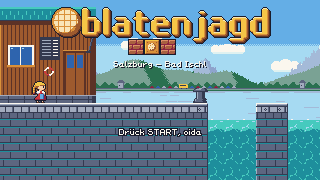 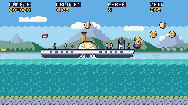
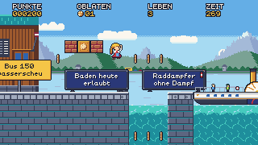 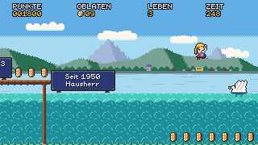
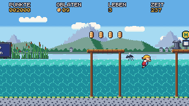 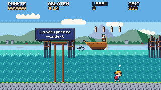
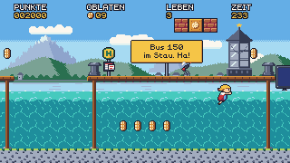 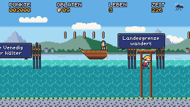
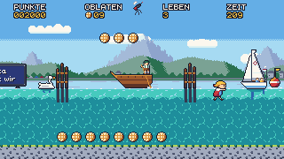 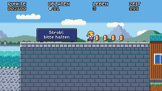
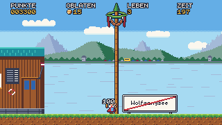 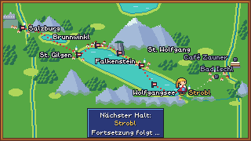

## What was built

| Area | Summary |
|---|---|
| Stage | `06_wolfgangsee.level`, 260×17, `camera = "autoscroll"`, zone `[16, 208]`. Seven sections and no lethal pits (D-074, D-085, D-087, D-090) |
| Auto-scroll camera | Lead-in, then a 0.75 px/frame scroll, then the lead-out. The left edge pushes Resi; she is only squeezed against a solid face. A right clamp keeps her 64 px from the right edge. The scroll holds 60 frames after a respawn. The camera rests at the bottom clamp, or frames high ground at screen y 84, with a top clamp at y 24. The lead-out catches up at ≤ 4 px/frame (D-075, D-083, D-086, D-090) |
| Swimming | Swim water (`see_wasser`) is separate from the lethal water. A chest point decides when she swims. She floats at the surface, holds DOWN to dive, strokes with JUMP, and jumps out at the surface. The lake bed counts as ground. Same numbers in every form; no stomps and no throws while swimming. A power change keeps a floater floating (D-076, D-086) |
| Boats | Traundl: the Gondel's free-running machine. Dampfer: the Festungsbahn's waiting machine, running one way and then moored; its paddle wheel hurts swimmers while it turns (D-077) |
| Enemies | Schwan: hiss, charge, swim home, rest; stomping it shows „Beleidigt!" (D-078). Gelse: waits until fully on screen, homes in, never enters water, leaves (D-079). Regattaboot: the Reisebus machine on the water; only an 8×20 masthead part bounces (D-080). Hackl classification (D-081) |
| Renderer | Draw layers: signs → items/platforms → enemies (D-086) |
| Tooling | Verify speed-up from ~8 min to ~1.5 min before Stage 6 (D-082). Squeeze lints for faces over swim water and for under-water faces against the lake bed (D-084, E31). Sign-board lint so no Oblate overlaps a board, with Stages 2–5 allowlisted (D-088). The solver handles swim stretches honestly (D-084) |
| Art | Swim anims for all three forms, 3 enemies, 2 boats and spray, 7 tiles, 5 props, `bg_suedufer`. Art-director APPROVED, each package in 2 rounds |

## Difficulty and numbers

| Stage | Solver | Narrowest window | Relaxed run | Time limit | Oblaten |
|---|---|---|---|---|---|
| St. Wolfgang | 2104, 20 jumps | 5 | ~89 s | 260 s | 76 |
| Wolfgangsee | 4410, 9 jumps | 10 (route-limited ≥ 6) | 90.0 s (explorer) | 270 s | 68 + 1 in the `?`-box |

The scroll fixes about 68 s of every run, so every route takes about the same time. The boats are the safe route with the most Oblaten, surface swimming is the exposed route, and the lake bed is safe but sparse (D-085). The solver mostly swims. Handwritten replays prove the boat hops, and every hop window there is at least 8 frames (D-085, D-087).

## Reviews and acceptance

- **QA:**
  - **Feature pass:** found 5 bugs.
    - The notch diver was squeezed. Fixed by moving the zone start (D-087).
    - Standing still on a deck pins Resi against a bollard. Accepted as the SMB3 rule, with an escape replay (D-087).
    - The Zaunerstollen was lost. Fixed by moving the box (D-087).
    - Shrinking while floating made her sink. Fixed in the engine (E32).
    - The camera snapped at the lead-out. Fixed in the engine (E32).
  - **Acceptance pass:** confirmed all of those fixes. It found 2 visual bugs:
    - The 1-up rose behind the HUD.
    - A perch bounce lifted the lake off screen.

    Both were fixed by D-090, and the replays that showed them are now passing regressions.
  - **Other checks:** a full-route replay from Salzburg to the Strobl teaser and back to the title passes as Hackl, never hurt. The wasm build loads with every level.
- **Art-director:**
  - **Assets:** all approved in 2 rounds per package.
  - **Stage 6 goldens:** approved in 4 rounds. The real renderer showed problems the mocks had not:
    - the camera rest height;
    - Oblaten hidden behind boards;
    - an enemy hidden behind a hull;
    - the lantern star in the HUD;
    - Oblaten reading as HUD icons.
  - **Acceptance:** a full contact sheet and every stage's solver filmstrip found one more problem: the moored steamer covered the „Baujahr 1873" board, so the board was moved. APPROVED.
- **Game-designer:** ACCEPTED. The German text is correct and within its limits, every fact is sourced, and the as-built spec is synced. Reviews along the way: D-085, D-087, D-089, D-090.
- **Code review:** E25–E34 were each reviewed and the blocking items fixed before merge:
  - E25: a search clock competing with the jump windows.
  - E30: stale docs and a lost Gelse test.

## Decisions in M5

D-074 … D-090 — see `docs/decisions.md`.

## Known issues

- **Verify time:** verify takes 320 s; the solver step is 271 s of that. Stage 6's long swim stretches make the solver's re-plans search long horizons. M6 needs a solver speed-up first (bound the re-plan horizon, or cache by content hash) (backlog).
- **Oblaten on sign boards:** 12 in Stages 2–5 overlap boards, allowlisted (D-088). Since D-086 the 12×12 ones show over board text.
- **HUD overlap:** items rising out of high boxes, and passing Gelsen, cross the HUD text for about 30 frames. Non-blocking (backlog).
- **Contact sheet:** the full `sprites sheet` exceeds ImageMagick's 16K px limit. Per-group sheets work.
- **Browser route:** still proven only by native replays plus wasm-smoke (MW).

## Deferred (see `docs/backlog.md`)

- **Design:** water skier, a tacking sailing boat, the steamer's sun deck, a breath meter, an underwater tint, fish (D-074).
- **Engine:** a step-up for the edge push (D-087); solver-replay staleness detection; animated swim water under `steg_pfahl`.
- **Art:** `see_wasser_tief` ripple density; small polish notes on the boats.

## Process notes

- **Parallel work:** four engine tasks and three art packages ran at once. Hash-tag ranges were reserved up front, so they had no id collisions this time. Each task left marked stubs (`// E26:`, `// E27: | Swim`) that E30 resolved.
- **Shared target directory:** worktree agents' builds overwrote each other's artifacts in the shared target folder. The stop hook now builds in its own target directory per checkout.
- **Real-renderer review:** the real renderer again found what mock composites hide. Most of M5's late changes came from looking at whole runs, not single shots: the steamer covering a board, the camera framing, the HUD clearance. The step-3 filmstrip review earned its place.
