# M6 – Stage 7 Strobl and Stage 8 Bad Ischl: Fensterläden, Ampeln and Autos, Kurgäste, Offiziere: milestone report

Date: 2026-10-21 · Branch `m6-strobl-bad-ischl` → merged into `main`, tag `m6`.

## Result

The route now runs Salzburg → St. Gilgen → Brunnwinkl → Falkenstein → St. Wolfgang → Wolfgangsee → Strobl → Bad Ischl. After Bad Ischl, the route map walks Resi on to Café Zauner and shows „Fortsetzung folgt …". The finale is M7.

**Stage 7 Strobl** starts at the Pension balconies, where Resi climbs window shutters that open and close on the stage clock. She crosses the Dorfplatz past the Gasthof and the Postbus, which for once stops („hält! Voll."). The Einfahrten have traffic lights whose four green blinks send out streams of cars. Then come the walkways bolted to the Bürglstein over the lake, with a Gelse, and E-Bikers who end in the Ischler Ache.

**Stage 8 Bad Ischl** is the Kaiser's town. It has the Jagdstandbild with a pigeon on the hat, spa guests whose deck chairs become steps once stomped, and files of officers who march, halt and present their sabres on the drill clock. Operetta tenors and a Fiaker are on the way too. The stage ends in the queue at Café Zauner.

`cargo xtask verify` passes on the milestone branch in 193 s with an empty solver cache, or about 60 s with a warm cache (D-091). It covers fmt, clippy, tests, the wasm build, lints, the solver, 432 replays (all deterministic), 172 approved goldens, wasm-smoke and vnc-smoke.

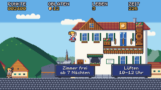 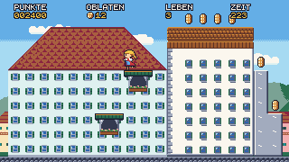
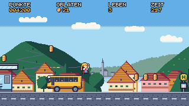 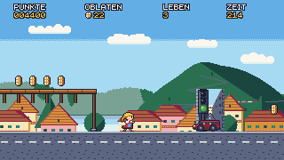
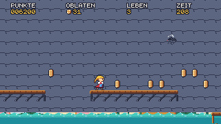 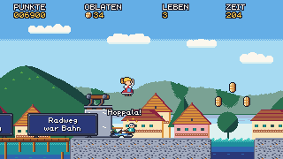
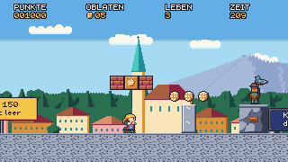 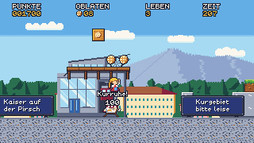
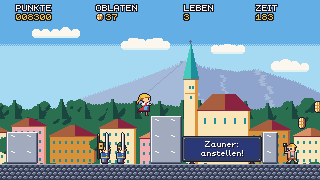 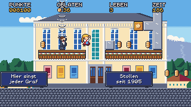
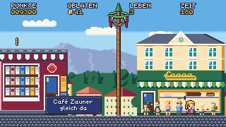 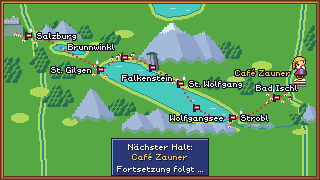

## What was built

| Area | Summary |
|---|---|
| Stages | `07_strobl.level` (280×17) and `08_bad_ischl.level` (300×17), both side levels with six sections each (D-092, D-100, D-101) |
| Solver speed-up (E35) | Parallel ranking, one shift queue across all levels, `MacroTree`, a word hash for `world_hash`. Solver results are cached by content hash in `$CARGO_TARGET_DIR/cache/solver/`, and stale solver replays fail verify. Cold verify went from 320 s to about 200 s with two more stages (D-091) |
| Ampel and Autos (E36) | A traffic-light spawner on its own counter (red-amber, cars, four green blinks, amber, red). The counter only runs while the light is in range, left of it and on screen (since D-102, the lamp housing must be on screen). Cars bounce Resi off the roof and hurt from the side. The Postbus is a Reisebus look (D-093) |
| Stage clock and Fensterläden (E37) | Frames of play since the stage start or the last respawn, in the state hash. Shutters are one-way platforms that are only on while open; a closing shutter drops a rider and never crushes her (D-094) |
| Kurgast (E38) | A slow walker. Stomped, he lies in his deck chair, a one-way platform, for 300 + 40 frames, and walkers turn 16 px before it (D-095, D-102) |
| Offiziere (E39) | Files that drill on the stage clock: march, „Habt Acht!", then „Präsentiert!" with an 8×10 sabre zone that is checked before the stomp. 200 points and „Abtreten!" (D-096, D-099, D-102) |
| Route map (E40) | Alternate label slots at Bad Ischl and Café Zauner (D-098). New tiles `felssteg`, `kies`, `einfahrt_bg`, plus 18 props |
| Integration (E41) | The `00_m6_mix` grey box with every new kind. The officer drill frame is clock − 1 + phase, and shutters run on clock + phase (D-099) |
| QA fixes (E42) | Sabre zone 8×10, deck-chair berth, Ampel lamp-housing test, B2 stone pier and bridge, Esplanade kerb, time limits from the relaxed runs (D-102) |
| Camera (E43) | A per-level side-camera top clamp: `camera_top = 76` in Bad Ischl, so the street stays on screen during the leap from B2 (D-103) |
| Art | Traffic, Strobl, Bad Ischl enemies and Bad Ischl packages: 3 car looks, the Postbus, the Ampel, shutters, Kurgast and deck chair, two officers, 3 tiles, 18 props and 3 background layers. Art-director APPROVED |

## Difficulty and numbers

| Stage | Solver | Narrowest window (gate) | Relaxed run | Time limit | Oblaten |
|---|---|---|---|---|---|
| Strobl | 1729, 17 jumps | 8 (5) | 75.05 s | 230 s | 78 + 1 in the `?`-box |
| Bad Ischl | 1851, 17 jumps | 5 (4) | 69.67 s | 210 s | 81 + 1 in the `?`-box |

Time limits follow D-045: 3 × the relaxed run on the ZEIT clock, rounded up to 10 s.

## Reviews and acceptance

- **QA:**
  - **Feature pass:** 5 bugs, all fixed in E42 (D-102) and kept as passing regressions (`qa_m6_*`).
    - The sabre hurt Resi on 2-high walls.
    - An officer walked into a Resi standing on a deck chair.
    - Ampel #1 stayed on red when the camera was raised.
    - The Bad Ischl Zaunerstollen rolled off balcony B2.
    - LEFT after the Bad Ischl respawn walked into the Traun.
  - **Acceptance pass:** PASS with 0 bugs.
    - It confirmed every fix with fresh probes in all three forms and fuzzed 47 M6 replays.
    - It checked pause, time-up and goal on the same frame, and game over and continue.
    - The full-route replay from Salzburg to the teaser and back to the title has no deaths. It also ran in the native app on the noVNC desktop.
    - 11 regression replays were added (`qa_m6a_*`).
- **Art-director:**
  - **Assets:** every package approved.
  - **Goldens:** approved in 4 rounds.
  - **Acceptance:** all sprite groups and the solver filmstrips of all eight stages. Stages 1–6 are unchanged.
    - One blocking problem: from the B2 pier the camera rose until the street was off screen, so the leap past singer #2 was blind. Fixed by D-103 / E43 and re-approved.
- **Game-designer:** ACCEPTED.
  - German text, lengths, sources and the satire's targets all check out, and the jokes land.
  - The as-built spec was synced: Stage 8 narrowest window 5 and the Oblaten totals.
  - D-103 also decided four art notes: two accepted, one to the backlog, and the sign text changed to „ab 7 Nächten".
- **Code review:** each of E35–E43 was reviewed, and blocking items were fixed before merge.

## Decisions in M6

D-091 … D-103 — see `docs/decisions.md`.

## Known issues

- **Browser route:** a wasm playthrough is not proven. wasm-smoke checks only the title, and the wasm build has no replay input. QA confirmed that the wasm binary embeds all eight levels and the same core as native, which plays the route (MW).
- **Resi above the screen:** on Bad Ischl's B2 leap, Resi is above the top of the screen for about 30–35 frames, and off the Alpenrose roof in Strobl her head is for about 12. Accepted under D-090/D-103; an off-screen marker is in the backlog.
- **Deck chairs in front of boards:** a resting deck chair can stand in front of a sign board in Bad Ischl. Accepted: each sign is read before Resi gets there (D-103 a).
- **Side camera in general:** the side dead zone comes down only slowly after a climb. Bad Ischl uses `camera_top`; a general ground settle would re-cut Stages 1–3, 5 and 7 (backlog).
- **Small cosmetic items from QA:** a deck chair can sit 2 px inside a wall, a car can spawn right at Resi's nose after its telegraph, and an unused `f12_path` warning (backlog).

## Deferred (see `docs/backlog.md`)

- **Design:** cars waiting at the light as platforms, a roundabout, the Katrin cable car, a salt-mine bonus room, brine pipes, and more (D-092).
- **Art:** a wing highlight for the Gelse (shared with Stage 6), a lower kerb sprite.
- **Engine:** side-camera ground settle, an off-screen player marker, overlapping deck-chair berths.

## Process notes

- **Solver first:** E35 landed before the M6 levels were solved. Two more long stages added only about 15 s to cold verify (320 → ~200 s with the faster solver), and the content-hash cache makes warm runs about 1 min.
- **Disk:** with up to ten agents in parallel, their build target dirs filled the 59 GB disk twice. Line-tables-only debug info halved each target dir. Dirs are now deleted right after each merge.
- **The design check catches wrong diagnoses:** the art-director's diagnosis of the B2 leap named a camera rule that doesn't apply to side levels. Asking the game-designer for a decision before handing it to an engineer found the real cause and a fix that leaves Stages 1–7 bit-identical.
- **Whole-run review again:** as in M5, the blocking acceptance finding came from the filmstrips, not from single golden shots.
