# M7 – Stage 9 Café Zauner: Kellner, the queue, the Oberkellner, the finale and the ending: milestone report

Date: 2026-10-21 · Branch `m7-cafe-zauner` → merged into `main`, tag `m7`.

## Result

The journey is complete: Salzburg → St. Gilgen → Brunnwinkl → Falkenstein → St. Wolfgang → Wolfgangsee → Strobl → Bad Ischl → **Café Zauner**.

**Stage 9** takes place inside the café, a single room where the camera never moves vertically:
- **Windfang and Garderobe:** waiters whose silver trays bounce Resi („Komm' gleich!").
- **Salon:** cake vitrines and chandeliers.
- **The queue:** nine Wartende on „Abstand halten" floor dots. Stomping all nine in a chain earns a 1-up; the chandeliers above form the upper route.
- **The counter:** the checkpoint „Reserviert / seit 1832".
- **The arena:** here the **Oberkellner** says „Hinten anstellen!" and fights three rounds of telegraph, dash and breather. From round 2 he also throws a volley of falling bills. Three stomps in his breathers beat him („Unerhört!", „Unerhört!", „Bitte sehr!"); he bows and the glass bell over the Zaunerstollen lifts.

**The finale:**
- Touching the Stollen gives 10 000 („Zaunerstollen!"), then the Serve with the plate held high, the tally, and „Mahlzeit, Resi!".
- **The ending** follows:
  1. A last map: every station done, „Ziel erreicht! / Salzburg – Café Zauner / Zu Fuß. Ohne Bus 150."
  2. The café illustration, with Postbus 150 driving past the window, full.
  3. The run's tally as a café bill.
  4. Six playbill credits pages.
  5. „Ende".
- **The title** then carries the „Durchgespielt! Mahlzeit!" mark with the Stollen plate at Resi's feet.

`cargo xtask verify` passes on the milestone branch in 212 s. It covers fmt, clippy, tests (including a per-frame check that no Stage 9 popup covers Resi or enters the HUD), the wasm build, lints, the solver (9 stages and every grey box), 491 replays (all deterministic), 198 approved goldens, wasm-smoke and vnc-smoke.

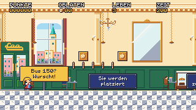 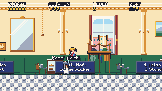
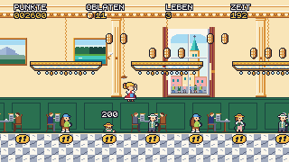 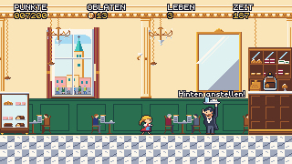
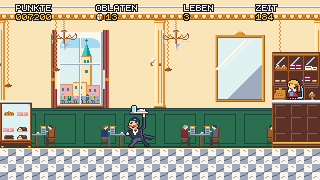 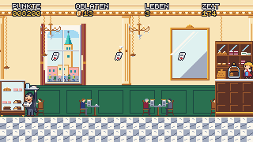
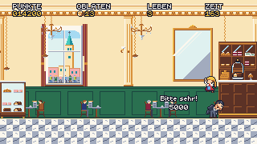 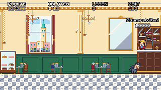
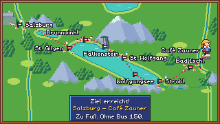 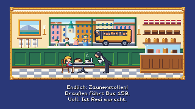
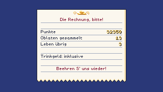 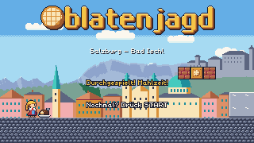

## What was built

| Area | Summary |
|---|---|
| Stage | `09_cafe_zauner.level`, 140×17, `camera_top = 92` (the bottom clamp, so the camera never moves vertically). Five sections and an arena of one screen; no pits (D-104, D-110, D-111) |
| Tooling (E44) | The full contact sheet is written as pages of at most 16 000 px each, so every sprite from M1 to M7 fits on one reviewable sheet (D-104) |
| Kellner and Wartende (E45) | The Kellner walks at 1.0, can't be stomped, and his tray bounces Resi without damage or points. A Wartender is a still Selfie-Tourist that is legal in stages, drawn in three looks that alternate along the queue (D-105, D-112) |
| Oberkellner (E46) | The arena locks at the camera's right clamp, and the fight runs on his own counter. Rounds use telegraph 40/36/32, dash 2.0/2.5/3.0 and breather 72/60/48; the bills hang, sway and fall. Hits 1000/1000/5000 sit outside the stomp chain. The arena lint, a `boss_hits=` expectation, and solver ranking by boss hits round it out (D-106) |
| Finale and ending (E47) | `goal_stollen`, armed once the boss falls; the Serve phase; `Mode::Ending` (Map, Scene, Bill, Credits, Ende); the run's Oblaten total; the `cleared` title mark; the `state=ending` and `cleared=` expectations (D-107) |
| Café tiles (E48) | `marmor`, `marmor_punkt`, `stuck`, `vitrine`, `theke`, `luster`; four café props; an opaque full-height background at factor 16 (D-104) |
| Integration (E49) | The `00_m7_cafe` grey box with every M7 kind, plus cross-task tests. A test checks that no fixed-room camera moves vertically in any replay. The `marmor_punkt` autotile alias; D-109 |
| QA and review fixes | E50: the marked title ignores START for 60 frames (D-111). E51: boss labels beside his head, the Stollen popup over the plate, and the goal clears leftover popups. E52: alternating Wartender looks (D-112). E53: the boss labels slide out of Resi's way, and the Stollen pair is clamped under the HUD in every form, checked on every frame of every Stage 9 boss and finale replay |
| Art | Café enemies (Kellner, three Wartender looks, an Oberkellner with nine anims, Rechnung); café tiles, props and `bg_zauner_salon`; the ending art (`ending_cafe`, `ending_zettel`). Art-director APPROVED, each package in 2 rounds |

## Difficulty and numbers

| Stage | Solver | Narrowest window (gate) | Relaxed run | Time limit | Oblaten |
|---|---|---|---|---|---|
| Café Zauner | 2270 frames, 14 jumps, with the fight | 12 (5) | 57.4 s | 200 s (the D-045 minimum) | 46 + 3 in `?`-boxes |

- **Boss, Normal-form win:** each press was shifted alone (the D-100 method), and every window is at least 26 frames (28 / 35 / ≥ 81 / 29, 26, 46 / 29, 29, 66 / 53).
- **Walk-only route:** every press is at least 12 frames.
- **Chandelier route:** 10–13 frames per hop.
- **Queue chain:** the nine-head chain to the 1-up is the optional skill line (≥ 5).
- **Tightness:** D-110 withdrew the 6–9 target for Stage 9. A pit-free café would need artificial squeezes to get tighter, and the climax is the boss.

## Reviews and acceptance

- **QA:**
  - **Feature pass:** one bug: a walking Resi couldn't pass the first vitrine because a box blocked the walking jump. Fixed by D-111, which moved the box and added a Stage 9 reach rule.
  - **Edge cases that passed:** goal on the time-up frame, time-up mid-fight, the bell closing after a respawn, pause in every boss state, START held or mashed through the ending, the bill's numbers, and game over and continue in the café.
  - **Acceptance pass:** FAIL with 2 bugs, both visual popup placement from E51. The boss's labels covered Resi after a low-bounce step-off from the counter, and the „Zaunerstollen!" pair rose into ZEIT for a Big or Hackl Resi. E53 fixed both and added the per-frame test. The other checks passed:
    - **Fixes confirmed:** D-111 (the first vitrine, in every form) and E50 (START ignored at 59, accepted at 60).
    - **Fuzzing:** about 105 000 random runs with no other violation.
    - **Second run:** a run after the marked title replays run 1 exactly.
    - **Native app:** the full route from the title to the marked title ran in the app on the noVNC desktop (37 900 frames), and 10 screenshots match the headless render pixel for pixel.
- **Art-director:**
  - **Assets:** all three packages approved in 2 rounds.
  - **Goldens:** the tour, finale and ending goldens were approved in 2 rounds. Round 1 found popups covering Resi at the climax, fixed by E51. E53's six goldens were approved in one round. Labels that slide 80–120 px from him after a low bounce still read as his reaction, because they appear exactly on the stomp.
  - **Acceptance:** the full paged contact sheet (every M1–M7 sprite) and all nine solver filmstrips. APPROVED, with four backlog notes.
- **Game-designer:**
  - **Reviews along the way:** Stage 9 as built (D-110) and the QA decisions (D-111).
  - **Acceptance:** ACCEPTED after one required change. All nine Wartende had been drawn in the same look, fixed by D-112 / E52.
  - **Text, facts and tone:** the German text, the sources and the tone are checked, and no living person is mocked.
- **Code review:** each of E44–E53 was reviewed, and the blocking items were fixed before merge. E49 also reviewed how E45, E46 and E47 interact.

## Decisions in M7

D-104 … D-112 — see `docs/decisions.md`.

## Known issues

- **Browser playthrough:** a wasm playthrough to the ending is not proven. wasm-smoke checks only the title, and the headless browser takes no input. The wasm binary embeds the café, the ending art and the ending text, and runs the same core as native, which plays the whole route (MW).
- **Resi above the screen:** in Bad Ischl and Strobl her head leaves the top of the screen for a moment (D-090, D-103).
- **Sprite overlap:** the Oberkellner's bow and breather overlap the vitrine or counter by a few px (accepted, D-111).
- **Signs covered:** moving enemies briefly cover signs in Stage 9 (backlog).
- **Debug-only backdrop:** starting a run directly in the café (`--level cafe_zauner`) puts the title over the café background (D-111).

## Deferred (see `docs/backlog.md`)

- **Design:** M7 extras (D-104), the Esplanade bonus, a stage select and saves.
- **Art:** St. Wolfgang Oblaten under the HUD; gold floor dots; the Falkenstein goal sign; the Gelse highlight; cast sprites on the credits.
- **Audio (MA) and web release (MW):** a polished page, gamepad support, and a browser smoke test that plays.

## Process notes

- **Parallel start:** five engine tasks and three art packages ran at once from one design commit. Reserved hash tags again prevented id clashes. The two tasks that finished last (E46, E47) merged the milestone branch into their own branch before handing back. That kept every merge into the milestone branch an already-verified tree.
- **Real art catches design gaps:** the art review found what the spec missed. The real art revealed that col mod 3 made the queue a row of clones, and the real popups covered Resi at the climax. Both came from reviewing rendered runs, not specs.
- **Disk:** with up to eight agents in parallel, deleting each worktree's target dir right after its merge kept the 59 GB disk below 81 %.
- **Measure every form:** E51's popup fix was checked only for Normal Resi, and QA's acceptance pass found the Big/Hackl case. E53 replaced the spot check with a per-frame pixel test over every boss and finale replay, which is the kind of check that would have caught it at once.
- **A slip:** one docs commit picked up unstaged changes after a failed merge, so E47 was briefly ticked before its merge landed. The content was right; checking `git status` before a commit-all would have caught it.
