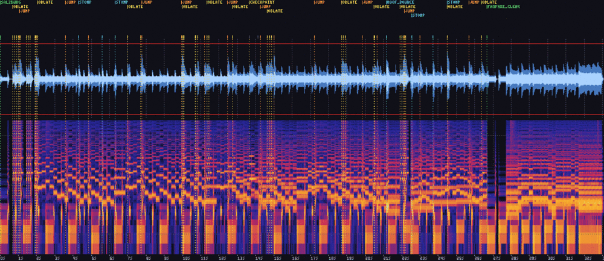
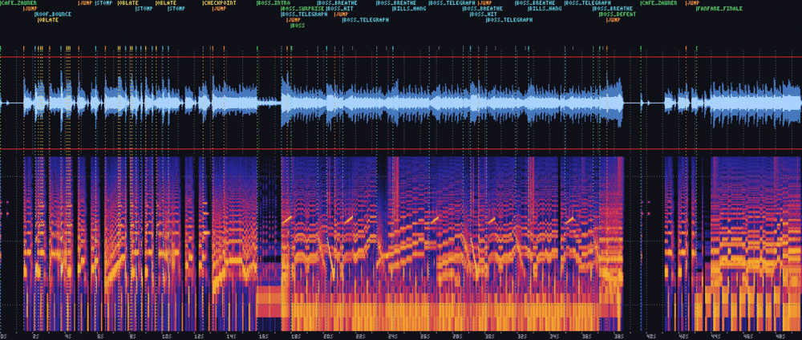
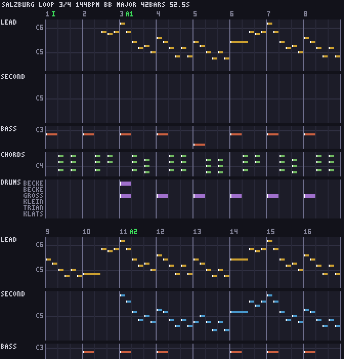

# MA – Audio: own synth, chiptune Blasmusik, a sound for every event: milestone report

Date: 2026-10-21 · Branch `ma-audio` → merged into `main`, tag `ma`.

## Result

**Oblatenjagd has sound.** Everything you hear is written as text and rendered at runtime by `jnr-audio`, the game's own integer-only synth. There are no samples, no DAW and no binary audio in git:
- **25 sound effects**, one for every event in audio-design §6.
- **25 music cues** for every stage and moment: 9 stage pieces, the underwater twin, title, map, the boss set, fanfares, death, game over, the ZEIT-60 bells and the ending set.
- **27 instruments**, the sounds the music is played on.

The sound is **chiptune Blasmusik**: oom-pah bass, Nachschlag chords, Flügelhorn tunes in parallel thirds, Ländler, polkas and a barcarole. The satire is in the quotes:
- **Mozart:** his own Ländler in Salzburg, *Eine kleine Nachtmusik* forced into 3/4, *Komm, lieber Mai* at every clear.
- **Haydn:** the *Surprise* chord when the Oberkellner wakes up.
- **Strauss:** the Radetzky clap-along in the Kurpark, and *Tritsch-Tratsch* in the café queue.
- **The Wolfgangsee:** a Christmas cradle song under its water.

Every quote is public domain. It was transcribed from a 19th-century edition, and a melody fixture fails `audio lint` if the tune drifts. The „Oblaten-Motiv" (1–3–5–4, „O-bla-ten-jagd") ties the score together.

**Audio is optional (D-115).** The game runs and plays the same on a machine with no sound device, with `--mute`, and in a browser without `audio.js`. **M** mutes and unmutes in place. Nothing in `jnr-core` changed except one output-only event (`Bounced`), and no replay hash changed.

`cargo xtask verify` passes on the milestone branch in 223 s. It covers:
- fmt, clippy and the tests;
- the wasm build;
- the arch, sprite, level and **audio** lints;
- the solver, 504 replays and 198 screenshot goldens;
- **31 cue-log goldens**, **50 audio PCM-hash goldens** and the **audio-mix** gate. That gate mixes every replay exactly as the app plays it and allows no sample above −1 dBFS;
- wasm-smoke, which tests with and without `audio.js`;
- vnc-smoke, which records 8 SFX onsets from the native app on a PulseAudio null sink, then runs again with no device.

Stage 1 solver run, offline mix (cue timeline, waveform against the −1 dBFS ceiling, spectrogram):

The Oberkellner fight, Normal win: intro chord, *Surprise* chord, boss loop, Tusch, café piece:

`salzburg`, the „Mozart-Landler, eh klar", bars 1–16 (piano roll: lead, second voice, Helikon, Nachschlag, drums):

## What was built

| Area | Summary |
|---|---|
| Design | `docs/audio-design.md`: identity, channels, the mix table, transitions, every piece and SFX specified so it can be checked without ears; the public-domain rule (D-113) |
| Spike | macroquad audio natively, in wasm and with no device; render cost; the playback model: per-sound WAVs, songs loop from sample 0, pause = volume 0, the underwater twin as a volume swap (D-114 … D-118) |
| E54 platform | The `audio` feature; the wasm link limited to quad-snd's imports, with a pinned `web/audio.js` (D-116); a panic guard and a 120-frame load budget (D-115); `--mute` and M; a PulseAudio null sink per vnc-smoke run (D-118) |
| E55 synth | `jnr-audio`: the `.sfx`/`.inst` parser, an integer synth, the renderer and a WAV writer; arch-lint keeps it integer-only (D-117) |
| E56 tooling | `cargo xtask audio render/lint/golden`: WAV, wave and spectrogram PNGs, JSON stats, signal lints against `audio/targets.toml`, PCM-hash goldens (D-119) |
| E57 songs | The `.song` tracker format with loops aligned to 4096 frames; music lints for meter, key, ranges and the loop point; the piano roll; melody fixtures for quotes (D-120) |
| E58 cues | Embedding through `jnr-assets/build.rs`; the `Bounced` event; the pure cue director (events and state diff → cues, exhaustive per event); level `music` ids; cue-log goldens (D-121) |
| E59 app | SFX loaded at startup and songs per stage (lazy, unloaded later); pause, ducking, jingles, the underwater swap; vnc-smoke audio capture |
| E60 offline mix | `cargo xtask replay <file> --audio`: the mix, a spectrogram, the cue timeline and the ceiling check; the `audio-mix` verify step shares the app's mix model (D-122) |
| E61 agents | The `sound-designer` agent and the `sfx-authoring` skill; docs |
| S1, S2 | The 25 must SFX and all 25 music cues; game-designer APPROVED, goldens accepted |
| E62 | Jingles are never ducked (D-123) |
| E63, E64 | The QA fixes: SFX headroom table, play-frame timers, rendered jingle lengths embedded at build time, unmute in place, the bells waiting for the boss jingles (D-124) |

## Mix numbers

| Run | Peak | Loudest moment |
|---|---|---|
| Worst of all 504 replays | −1.56 dBFS | `bad_ischl` + `hohes_c` + `jump` |
| Stage 1 solver run | −3.04 dBFS | `oblate` + `salzburg` + `stomp` |
| Boss win (Normal) | −3.7 dBFS | `boss_surprise` + `boss_telegraph` + `jump` |
| Music loops | ≤ −8 dBFS, RMS −20 ± 2 | lint per loop |

No replay clamps a sample. Every SFX plays at 89 % (−1 dB). `hurt` and `oneup` play at 89 % of that, and `hohes_c` at 84 % (D-124).

## Reviews and acceptance

- **Game-designer (the audio gate, D-117):**
  - **S1, S2:** every SFX and piece was APPROVED from its stats, spectrograms, piano rolls and quote fixtures. Only after that were the goldens accepted with `cargo xtask audio golden --accept`.
  - **Acceptance review:** the cue logs of a Stage 1 tour and the Normal boss win, and the offline mixes. One finding: jingles were ducked under SFX, fixed by E62 / D-123. audio-design.md was updated "as built".
  - **QA re-reviews:**
    - approved the shortened `fanfare_finale` and the SFX gain table;
    - asked that the café piece wait for the ZEIT-60 bells after the Tusch, so its cup clinks don't land on the third strike.
- **QA:**
  - **Acceptance pass:** FAIL with 6 bugs:
    1. the mix clipped in 34 replays;
    2. pause during the bells;
    3. pause during the boss jingles;
    4. the bells cut the Tusch;
    5. the fanfares were cut by the maps;
    6. unmute restarted the song.
  - **Fix:** E63 fixed them, with one game-designer item (shortening `fanfare_finale`). Each bug is now a `qa_ma_*` replay with a cue golden.
  - **Confirmation pass:** all six fixes confirmed, plus 30 pause and ZEIT-60 edge probes. It also found 3 one-frame coincidences, where ZEIT 60 lands exactly on the arena lock, on DONE, or on the boss loop's due frame. E64 fixed them.
  - **Native runs:** the app ran on the noVNC desktop with a real Pulse sink and repeated M presses (underwater swap, `--mute` start, pause, jingles), with no panic.
- **Code review:** every task was reviewed before merge. E63 was blocked once: shifting the deadlines on resume waited for jingles that had already finished silently. The fix was approved in round 2.

## Decisions in MA

D-113 … D-124 — see `docs/decisions.md`.

## Known issues

- **Browser playthrough:** a browser playthrough with sound isn't proven. wasm-smoke checks that the module loads with `audio.js`, and that the game still runs and logs the load timeout without it. The headless browser has no audio output and takes no input (MW).
- **Native timing:** native audio timing is quantised to quad-snd's ~93 ms blocks. Cues land up to one block late (D-114).
- **Hard cuts:** there are no fades or crossfades. Transitions are hard cuts at a song's start, by D-114's model. A pause holds a jingle at volume 0 while it keeps running, so a jingle that ends during the pause is not heard after it.
- **Pre-fight bells:** if the arena locks while the ZEIT-60 bells ring before the fight, `boss_intro` cuts the bells (audio-design §4, as built).
- **Unused render:** the hurry (+12 %) tempo variant renders, but no cue uses it.
- **Double render:** `cafe_zauner` is rendered a second time when it comes back after the boss.
- **Warning:** a `cli::f12_path` unused-code warning in a non-default configuration.

## Deferred (see `docs/backlog.md`)

- **S3:** the nice SFX and music in audio-design §10's reverse cut order. These are the ambience loops (Gelse, bees, steam), footsteps, extra telegraph sounds, and the nice music variants: tempo steps, the map transposition, the climb and power-state layers.
- **Music credits:** a music credits page naming every quoted work.
- **Fades:** fades and crossfades, which would need a streaming mixer instead of per-sound WAVs.
- **MW:** a playtested browser build with sound, and gamepad support.

## Process notes

- **Judging sound without ears works when the evidence is exact.** Stats, spectrograms, piano rolls, quote fixtures and cue logs let the game-designer reject concrete things: a ducked jingle, a fanfare too long for its scene, clinks landing on a bell strike. None of it needed a listener.
- **Mix every replay.** The first audio-mix gate mixed a handful of runs and passed. QA's sweep over all 499 found 34 clipping coincidences. With shared renders and bounded threads the full sweep costs 1.6 s, so it is now the gate.
- **Check playback-model assumptions in review.** E63's pause fix assumed jingles pause in place. The reviewer read D-114 and the mixer code and showed that a held jingle keeps running silently. The cue logs looked plausible either way; only the model said which was right.
- **One-frame coincidences** between independent timers (ZEIT 60 and the boss state machine) only showed up when QA built replays that put both on the same frame. Each now has a cue golden.
- **Disk:** a `cp` of a target dir filled the disk once. Deleting each worktree and its target dir right after its merge kept it at about 80 %.
